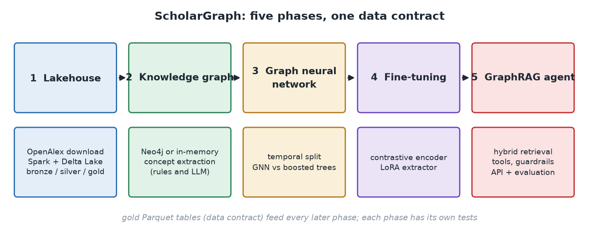

# ScholarGraph

A scholarly **knowledge-graph platform** over [OpenAlex](https://openalex.org): a Spark/Delta Lake lakehouse, a property-graph knowledge graph, a citation-prediction graph neural network, contrastively fine-tuned embeddings and a LoRA-fine-tuned concept extractor, and a **GraphRAG question-answering agent** with guardrails, graph-derived evaluation and an HTTP API.

**Tags:** `knowledge-graph` · `graph-neural-network` · `rag` · `graphrag` · `llm-agents` · `fine-tuning` · `lora` · `contrastive-learning` · `pyspark` · `delta-lake` · `neo4j` · `pytorch` · `fastapi` · `openalex`



## Status (read this first)

The system is **implemented and unit-tested**, and a **small real-data run** (10,000 real papers, CPU only) has been done; the full-scale run (300,000 papers, GPU or Mac, a real language model) has not. This table says exactly what has been verified.

| Phase | What it is | Implemented | Unit-tested | Real-data run |
|---|---|---|---|---|
| 1. Lakehouse | resumable OpenAlex download, bronze / silver (Delta) / gold (Parquet), data-quality checks | yes | yes (Spark = pandas, verified in a Linux container) | 10,000-paper slice done (pandas engine); full slice pending |
| 2. Knowledge graph | store interface, in-memory and Neo4j stores, rule and LLM concept extraction with grounding | yes | yes (Neo4j loader tested with a recording driver; live Neo4j parity test passed) | rule-based concepts on the 10,000-paper slice done; LLM extraction pending |
| 3. Graph neural network | temporal split, hidden-paper protocol, directed GraphSAGE in plain PyTorch, boosted-tree baseline | yes | yes | 10,000-paper slice done: baseline and GNN, 3 seeds; full slice pending |
| 4. Fine-tuning | contrastive encoder (InfoNCE, hard negatives), LoRA concept extractor, retrieval evaluation | yes | yes (wiring, leakage, metrics) | pending (GPU or Apple Silicon) |
| 5. GraphRAG agent | BM25 + dense + graph retrieval, guardrails, 12-tool agent, evaluation harness, FastAPI + metrics | yes | yes (scripted policy scores 100% on graph-derived questions, synthetic and real) | retrieval benchmark and System 1 on the real slice done; a small local-model check: see the Implementation Guide |
| 5b. Reliability and advanced agents | evaluation upgrades, OpenTelemetry tracing, lifecycle hooks, structured output, System 1 layer (safety, cache, direct handlers, trained router and verifier), planner and verifier agents, memory with safety rules, MCP server and client, rerankers, communities, multi-hop, efficiency tools, DPO | yes | yes (live Neo4j parity and a real MCP subprocess included) | partly: see "Real-data smoke run" |

Numbers appear only where they were measured: the small real-data run below. Everything else (full-scale run, neural encoders, fine-tuning, stronger language models) is marked pending in the Implementation Guide.

## Real-data smoke run (10,000 papers, CPU, no API key)

A first run on 10,000 real, highly cited AI papers (24 MB of raw pages), with TF-IDF text features and no language model. Real measurements on a small slice, **not the final results**; details and caveats are in the Implementation Guide.

| Citation prediction (cold start, test = citations of 2024-2025 papers, 99 negatives each) | Hits@10 | MRR | AUC |
|---|---|---|---|
| popularity of the candidate | 0.365 | 0.206 | 0.643 |
| text cosine alone | 0.698 | 0.405 | 0.883 |
| boosted trees, eight hand-made features (mean of 3 seeds) | 0.700 | 0.379 | 0.906 |
| graph neural network (mean of 3 seeds) | **0.771** | **0.471** | **0.924** |

| Retrieval (300 test-period queries, leak-free graph) | MRR | Recall@20 |
|---|---|---|
| BM25 / dense / hybrid | 0.369 / 0.360 / 0.393 | 0.151 / 0.153 / 0.159 |
| hybrid + graph bonus | **0.449** | **0.202** |
| hybrid + lexical reranker (hurts) | 0.273 | 0.132 |

On 70 questions generated from the real graph the System-1 engine answered all of them exactly with **zero model calls** (mean 11 ms); the same questions through the agent cost 2.9 model calls each. (The handlers were written for the generator's phrasings, so this shows the zero-model path works, not how many real users' questions it would recognise.) The run also exposed several problems that the unit tests had missed (an API paging rule, a leak of the future into training, a leaky retrieval benchmark); each is now fixed and tested, and described in the Implementation Guide.

## Documentation

| File | Content |
|---|---|
| [`docs/Project_Scope_and_Aims.pdf`](docs/Project_Scope_and_Aims.pdf) | aims with success criteria, data, evaluation plan, scope, risks, status |
| [`docs/Implementation_Guide.pdf`](docs/Implementation_Guide.pdf) | how each phase works, the data contract, tests, how to run, limitations |

## Quick start

```bash
pip install -e ".[dl,serve,baseline]"        # Python 3.10+; add ",spark" (Java 17/21) or ",graph" (Neo4j) as needed
python -m unittest discover -s tests -t .    # 226 tests (live Neo4j tests run only with NEO4J_URI set)
python -m scholargraph demo                  # all five phases on a synthetic network, no downloads
```

On the real data (see the Implementation Guide for details):

```bash
export OPENALEX_API_KEY=...                  # free key from openalex.org/settings/api-key: REQUIRED beyond 10,000 works (never commit it)
python -m scholargraph ingest                # resumable; default slice: 300,000 most cited AI papers, 2015-2025
python -m scholargraph lake --engine pandas  # or --engine spark (Linux / macOS / Docker)
python -m scholargraph concepts --extractor rules
python -m scholargraph baseline && python -m scholargraph train-gnn
python -m scholargraph finetune --hard-negatives
python -m scholargraph serve --llm ollama:llama3.2:3b          # POST /query runs the System-1 engine
python -m scholargraph query "Who wrote the paper titled \"...\"?"   # route, answer, model calls, milliseconds
python -m scholargraph eval-agent --engine --golden data/eval/golden.json --baseline data/eval/baseline.json
python -m scholargraph mcp-serve                                 # expose the graph tools to any MCP client
```

Spark on native Windows needs the Hadoop `winutils` helper; use the Docker image instead:
`docker build -f docker/Dockerfile.spark -t scholargraph-spark .`

## Data and privacy

OpenAlex data is CC0. The downloader reads your API key from the environment (without one it stops at 10,000 works), never writes it to disk, and never asks for or transmits an e-mail address. Downloaded data, models and run logs are git-ignored; the repository contains only code, four real API records used as a test fixture, tests and documents.

## Design principles

- **One data contract.** Phase 1 writes nine gold Parquet tables; phases 2 to 5 read only those, with pandas, so they need neither Spark nor Java.
- **Leakage-free evaluation.** Temporal split by the citing paper's year; hidden-paper training so that training looks like cold-start testing; no future text in fine-tuning pairs; none of it is assumed, all of it is tested.
- **A baseline for every model.** The GNN is compared with a boosted-tree model on the same pairs and candidates.
- **Interfaces over vendors.** `GraphStore` (memory or Neo4j) and `LLM` (Ollama, OpenAI-compatible, Anthropic, or a scripted fake) keep tests free and the system portable.
- **Honest reporting.** Tested facts are separated from pending measurements.

## Layout

```
src/scholargraph/   ingest, lake, graph, gnn, finetune, rag, agent, evalkit, api, system1, memory, mcp (+ cli, llm, structured, observability, efficiency, embeddings, schemas)
tests/              226 tests (lake, ingest, graph, neo4j live, gnn, finetune, rag/agent, embeddings, structured output, hooks and tracing, evalkit, system1, multi-agent, memory, retrieval upgrades, mcp, efficiency and learning)
docker/             Dockerfile.spark, neo4j.yml
docs/               the two PDFs, figures, and the sources that build them (docs/build)
scripts/            make_fixture.py, make_figures.py
```

## License

MIT, see [`LICENSE`](LICENSE). © 2026 Evangelos Tempelopoulos.
